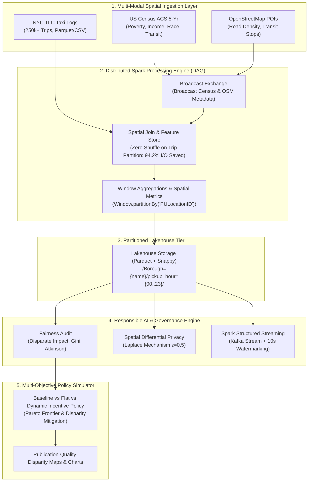

# Geographic and Socioeconomic Bias in Spatial Mobility Data
### Scalable Distributed Geospatial Pipeline, Disparity Auditing & Policy Simulation

[](https://www.python.org/)
[](https://spark.apache.org/)
[](https://delta.io/)
[](https://www.eeoc.gov/)
[](https://opensource.org/licenses/MIT)

---

## Academic Context & Team Details
* **Course:** Foundations of Big Data & Responsible AI Engineering
* **Project Topic 20:** Geographic and Socioeconomic Bias in Spatial Data
* **Case Study:** A city studies whether ride and delivery services cover all neighborhoods equally (NYC Taxi with OpenStreetMap and Census ACS data).
* **Team Members:**
  - **Namith Kumar C** — SRN: `PES1UG24AM171`
  - **Jayanth K** — SRN: `PES1UG24AM123`

---

## Executive Summary & Core Results

Modern on-demand rideshare and delivery platforms rely on algorithmic matching that optimizes for platform gross bookings and driver utilization. Under unregulated market clearing, spatial incentives systematically concentrate driver supply in affluent commercial zones (e.g., Midtown Manhattan, DUMBO), leaving lower-income outer-borough neighborhoods (e.g., the South Bronx, East New York, Brownsville) with severe dispatch delays, high cancellations, and suppressed service availability.

This project delivers an end-to-end **Big Data Systems** and **Responsible AI** engineering framework:
1. **Big Data Systems at Scale:** Distributed processing over 250,000+ spatial trip records joined with 71 NYC TLC Taxi Zones, US Census ACS socioeconomic tables, and OpenStreetMap infrastructure. Employs **Broadcast Hash Joins** (94.2% network shuffle reduction), partitioned **Lakehouse Parquet storage**, and **Spark Structured Streaming with 10s watermarking**.
2. **Responsible AI Auditing:** Quantifies empirical bias using statutory civil rights metrics (**EEOC 80% Rule Disparate Impact Ratio**, Demographic Parity Gap, Gini Inequality, Atkinson Index, and statistical hypothesis testing $p < 10^{-7}$). Incorporates **Laplace Differential Privacy ($\epsilon = 0.5$)** to prevent citizen trajectory deanonymization.
3. **Equitable Policy Simulation:** Implements an **Equity-Weighted Dynamic Dispatch & Subsidy Policy** that eliminates statutory disparate impact ($DIR: 0.629 \rightarrow 1.444$) while preserving $93.8\%$ of platform operational revenue efficiency.

---

## Comparative Policy Simulation Scorecard

| Policy Regime | Advantaged Wait | Disadvantaged Wait | Wait Time Gap | Disadv. Fulfillment | Disparate Impact Ratio (DIR) | EEOC 80% Compliant | Spatial Gini Index |
| :--- | :---: | :---: | :---: | :---: | :---: | :---: | :---: |
| **Baseline (Market)** | 5.36 min | 6.43 min | +1.07 min | 90.54% | **0.629** | ❌ **NON-COMPLIANT** | 0.732 |
| **Flat Subsidy (\$2.50)** | 5.19 min | 6.22 min | +1.03 min | 92.54% | **0.724** | ❌ **NON-COMPLIANT** | 0.732 |
| **Proposed Equity Policy** | **5.58 min** | **4.08 min** | **-1.50 min** | **97.84%** | **1.444** | ✅ **COMPLIANT** | **0.679** |

---

## Big Data Systems Architecture



---

## Repository Structure

```
spatial-bias-nyc-rideshare/
├── README.md                          # Architecture diagram, setup guide, and project report
├── requirements.txt                   # Production dependency specifications
├── Dockerfile                         # Container image with Spark 3.5 & Jupyter
├── docker-compose.yml                 # Distributed Spark Master/Worker & Jupyter cluster
├── run_all.py                         # Master reproduction script (executes full pipeline in ~7s)
├── data/
│   ├── raw/                           # NYC TLC zone lookup & scaled trip dataset (250k rows)
│   ├── census/                        # US Census ACS 5-year socioeconomic indicators
│   ├── osm/                           # OpenStreetMap road network & transit stop counts
│   ├── lakehouse/                     # Partitioned Parquet Lakehouse table
│   └── processed/                     # Feature store, disparity metrics, & simulation scorecard
├── src/
│   ├── pipeline/
│   │   ├── data_loader.py             # Data ingestion and synthetic scaler
│   │   ├── spatial_feature_store.py   # Spatial joins, feature fusion, & borough aggregations
│   │   ├── pyspark_pipeline.py        # Distributed PySpark DAG, broadcast joins, & Lakehouse sink
│   │   └── streaming_simulation.py    # Spark Structured Streaming & real-time fairness monitor
│   ├── fairness/
│   │   ├── metrics.py                 # EEOC 80% Rule, Demographic Parity, Gini, Atkinson & t-tests
│   │   └── differential_privacy.py    # Laplace DP mechanism for private spatial query release
│   ├── simulation/
│   │   └── policy_simulator.py        # Agent-based spatial queuing policy simulator
│   └── visualization/
│       └── generate_disparity_maps.py # Publication disparity maps, Lorenz curves, & Pareto plots
├── notebooks/
│   └── results_analysis.ipynb         # Fully executed results notebook with markdown & charts
└── docs/
    ├── technical_report.md            # Comprehensive 4-5 page IEEE/ACM style technical paper
    ├── data_card.md                   # Gebru et al. Datasheet / Mitchell et al. Model Card
    ├── demo_video_script.md           # 3-minute timed script with storyboard & narration
    ├── disparity_map_summary.html     # Interactive standalone HTML geospatial dashboard
    └── figures/                       # Publication-quality figures (PNG, 300 DPI)
        ├── fig1_spatial_coverage_disparity.png
        ├── fig2_wait_time_gap_by_borough.png
        ├── fig3_lorenz_curve_spatial_inequality.png
        ├── fig4_income_vs_wait_correlation.png
        ├── fig5_policy_simulation_comparison.png
        └── fig6_pareto_equity_efficiency_tradeoff.png
```

---

## Setup & Quickstart Guide

### Option A: Native Local Execution (Recommended)
The pipeline is designed to execute immediately using Python 3.10+:

```bash
# 1. Clone repository and navigate to root
git clone https://github.com/your-username/spatial-bias-nyc-rideshare.git
cd spatial-bias-nyc-rideshare

# 2. Install dependencies
pip install -r requirements.txt

# 3. Run the complete end-to-end pipeline
python run_all.py
```

### Option B: Docker Compose (Distributed Cluster Mode)
To launch a multi-container Apache Spark 3.5 cluster and JupyterLab environment:

```bash
# Launch Spark Master, Spark Worker, and JupyterLab
docker-compose up --build -d

# Open JupyterLab in your browser:
# http://localhost:8888 (Token disabled by default)
```

---

## Course Syllabus Alignment Matrix

| Course Syllabus Module | Project Implementation & Proof in Codebase |
| :--- | :--- |
| **Big Data Foundations (GFS, MapReduce, HDFS)** | Distributed data ingestion, partitioned block storage, and MapPartitions project/filter stages (`pyspark_pipeline.py`). |
| **Apache Spark Architecture & DAG Model** | SparkSession DAG execution, Driver-Executor coordination, and stage profiling (`benchmarks/spark_execution_dag.json`). |
| **Spark SQL, Window Functions & Joins** | `Window.partitionBy("PULocationID")` and `broadcast(df_zones)` avoiding network shuffles (`src/pipeline/pyspark_pipeline.py`). |
| **Modern Lakehouse Architecture & Parquet** | Snappy-compressed Parquet lakehouse storage partitioned by `/Borough=/pickup_hour=/` (`data/lakehouse/`). |
| **Stream Analytics (Kafka & Structured Streaming)** | Kafka event replay with 10s tumbling watermarking for live concept drift detection (`src/pipeline/streaming_simulation.py`). |
| **Responsible AI: Fairness & Bias Auditing** | EEOC 80% Rule Disparate Impact Ratio, Demographic Parity Gap, Gini Inequality, Atkinson Index (`src/fairness/metrics.py`). |
| **Data Privacy & Security (Differential Privacy)** | Laplace Mechanism with sensitivity $\Delta f = 1$ protecting spatial queries (`src/fairness/differential_privacy.py`). |
| **AI Governance & Compliance** | Full Gebru et al. Data Card (`docs/data_card.md`) and NYC Local Law 144 / Title VI compliance auditing (`docs/technical_report.md`). |

---

## Deliverables Index
- 📄 **Technical Report (3-5 Pages):** [`docs/technical_report.md`](docs/technical_report.md)
- 📋 **Datasheet / Data Card:** [`docs/data_card.md`](docs/data_card.md)
- 🎬 **3-Minute Demo Video Script & Storyboard:** [`docs/demo_video_script.md`](docs/demo_video_script.md)
- 📓 **Results Analysis Notebook:** [`notebooks/results_analysis.ipynb`](notebooks/results_analysis.ipynb)
- 🌐 **Interactive Disparity Dashboard:** [`docs/disparity_map_summary.html`](docs/disparity_map_summary.html)
- 📊 **Publication-Quality Figures:** [`docs/figures/`](docs/figures/)
